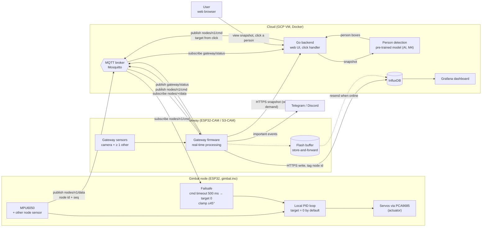
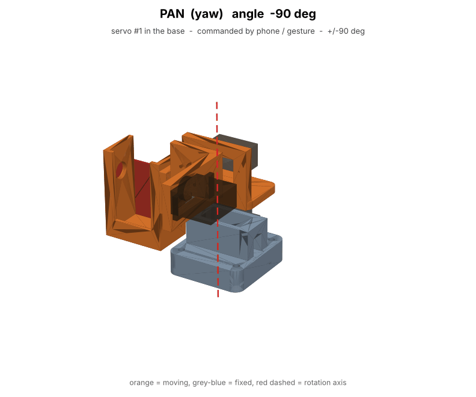
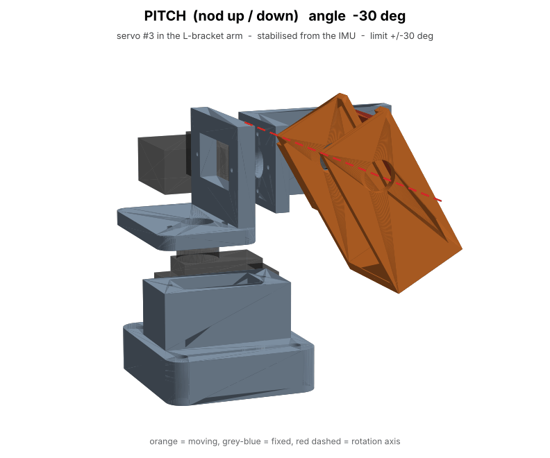
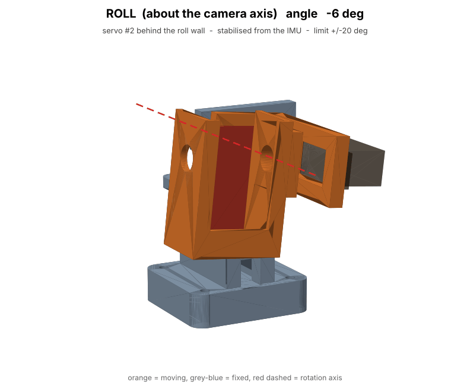

# Basic Gimbal Project for Embedded Class

`Chicken gimbal` is basic gimbal simulation project for Embedded Class in CEDT 2026.

## Project Architecture Layout

Click-to-track: the user clicks a person in a snapshot on the dashboard, the cloud AI turns the click into a target angle, and the gimbal pans there while its local PID keeps it stable.

Every device talks through one MQTT broker, so adding a node only needs a new node id in the topic.



## Development

For developement mode, we use local-influxDB container which can started by running this command:

```bash

```

## (Production) Intialize Cloud Instance (Google Cloud) for Cloud Storage

To use the cloud storage to keep the data, we already provided terraform command to initialize the compute engine in google cloud.

### Quick way (Makefile)

Do the login, API enable and `terraform init` once with the manual steps below, then:

```bash
cp .env.example .env        # then put your project id in GOOGLE_CLOUD_PROJECT
make tf-plan                # preview
make tf-apply               # create the VM + data disk
make tf-destroy             # tear down (deletes the data disk too)
```

Finding the VM's IP, SSH and mounting the disk are manual (steps 4 and 5 below).

### Prerequisites

- [Terraform](https://developer.hashicorp.com/terraform/install) and the [gcloud CLI](https://cloud.google.com/sdk/docs/install) installed [Document](https://developer.hashicorp.com/terraform/tutorials/aws-get-started/install-cli)
- A Google Cloud project with billing enabled and the Compute Engine API turned on:

```bash
gcloud services enable compute.googleapis.com --project <PROJECT_ID>
```

### Steps

1. Log in so Terraform can access your Google Cloud account (this creates Application Default Credentials; `gcloud auth login` alone is not enough):

```bash
gcloud auth application-default login
```

1. Set your project in `infra/terraform/dev/terraform.tfvars`:

```bash
project_id = "<PROJECT_ID>"
region     = "asia-southeast1"
zone       = "asia-southeast1-a"
```

3. Initialize, preview, and create the resources:

```bash
cd infra/terraform/dev
terraform init
terraform plan
terraform apply
```
Type `yes` when asked. This creates a service account, a 20 GB data disk (`app-data-disk`) for InfluxDB, and an `e2-medium` VM (`db-instance`) with the disk attached.

1. Find the VM's public IP and connect:

```bash
gcloud compute instances describe db-instance --zone asia-southeast1-a \
--format='get(networkInterfaces[0].accessConfigs[0].natIP)'
gcloud compute ssh db-instance --zone asia-southeast1-a
```
The IP is ephemeral and changes if the VM is stopped and started.

1. The data disk is attached but not formatted or mounted. Do this once on the VM (the disk shows up as `/dev/disk/by-id/google-data`):

```bash
sudo mkfs.ext4 -m 0 /dev/disk/by-id/google-data
sudo mkdir -p /mnt/data
sudo mount /dev/disk/by-id/google-data /mnt/data
```

Then point InfluxDB's data volume at `/mnt/data`.

### Tear down

To stop being billed, delete everything Terraform created (this also deletes the disk and its data):

```bash
cd infra/terraform/dev
terraform destroy
```

> `infra/terraform/prod` is an unfinished AWS placeholder and is not used by this guide.

# Design
This is our project 3D design in each perspective.

## Pan View


## Pitch View


## Roll View
